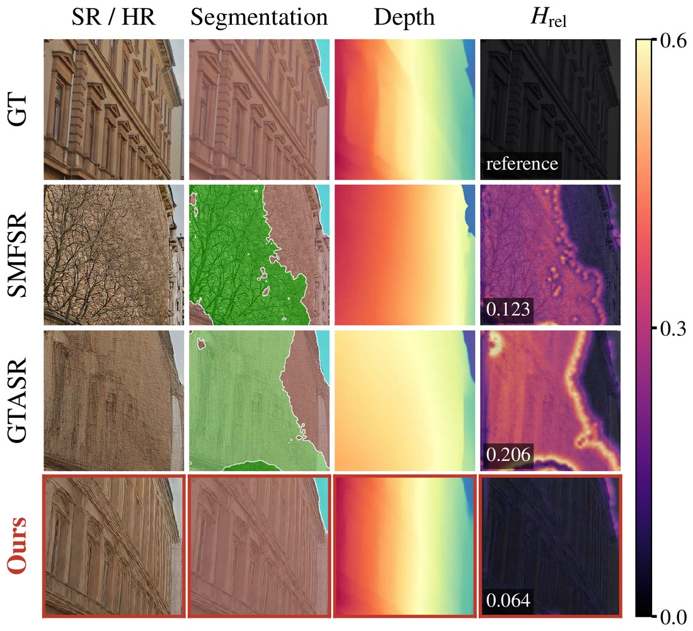
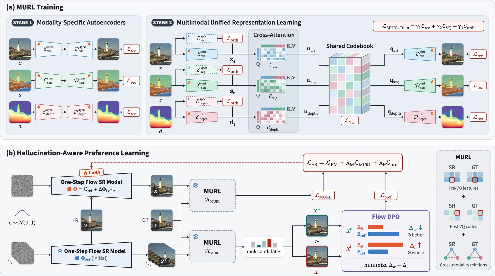
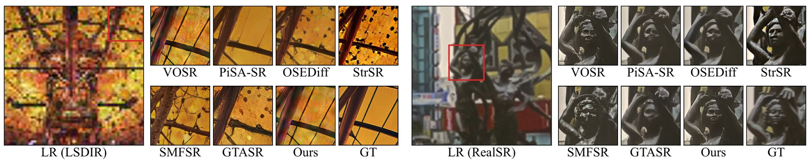
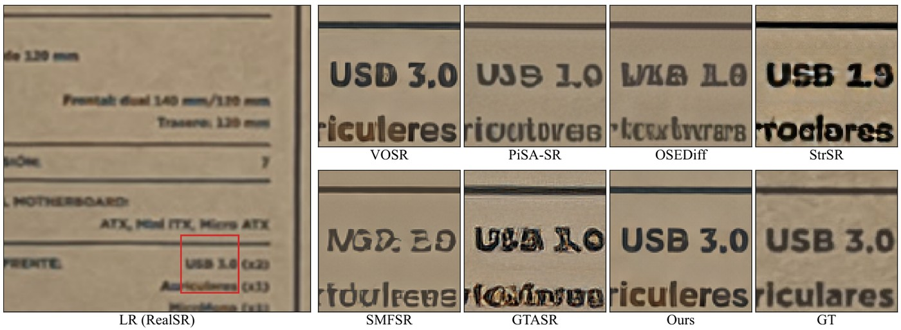
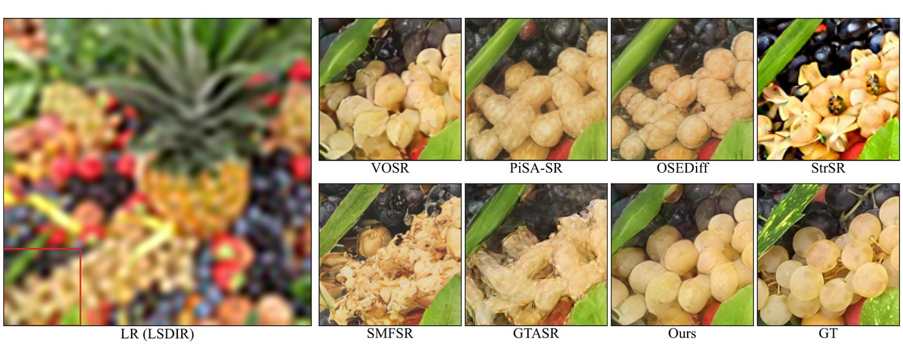
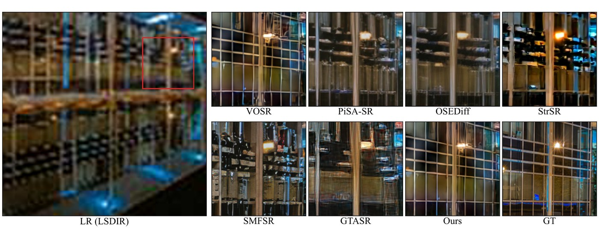
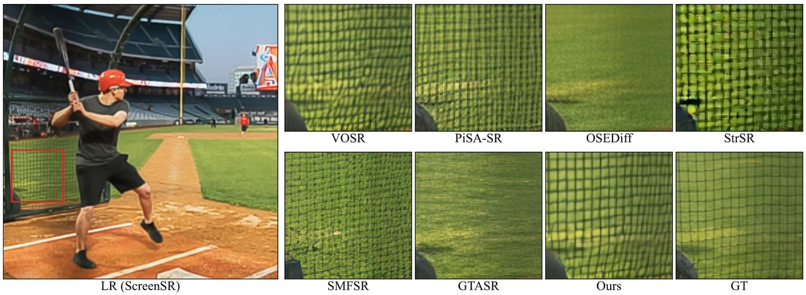

<div align="center">

<picture>
  <source media="(prefers-color-scheme: dark)" srcset="assets/wordmark_dark.png">
  
</picture>

### Hallucination-Aware Preference Learning with Multimodal Unified Representations for Perceptual Image Super-Resolution


<a href="https://huggingface.co/kooroshrh/MURL-SR"></a>
<a href="LICENSE"></a>



</div>

Generative super-resolution models produce sharp textures, but often invent details that are inconsistent with the scene. **MURL-SR** measures these hallucinations with a **Multimodal Unified Representation (MURL)** of visual appearance, semantic segmentation and depth, and uses it to train a one-step flow SR model in two ways: as a direct loss, and as a reward that ranks candidate outputs for **hallucination-aware DPO**. MURL is used only during training, so inference costs exactly one network evaluation.

## Method

<div align="center"></div>

**(a)** MURL learns modality-specific autoencoders (stage 1), then unified representations that interact through cross-attention and share one vector-quantized codebook (stage 2). The hallucination measure $\mathcal{H}_\text{MURL}$ compares SR and ground truth before quantization, after quantization, and in their cross-modal relations. **(b)** A frozen reference model generates $K$ candidates per LR image; the lowest and highest $\mathcal{H}_\text{MURL}$ form a preference pair for flow DPO, trained jointly with direct MURL supervision.

## Results

<div align="center"></div>

<details>
<summary><b>More comparisons</b></summary>
<br>




</details>

## Installation

```bash
git clone https://github.com/KooroshRH/MURL-SR.git
cd MURL-SR
pip install -r requirements.txt
```

## Inference

```bash
python scripts/inference.py -i path/to/lr_images -o results
```

The MURL-SR weights and VOSR's VAE are downloaded from Hugging Face on the first run. The default is 4x upscaling with VOSR's wavelet color correction (`--upscale`, `--seed` and `--no-color-fix` change this).

MURL-SR is a fine-tuned [VOSR-1.4B one-step](https://github.com/cswry/VOSR) model, and its checkpoint uses VOSR's format (`args.json` + `ema_model.safetensors`). The two are interchangeable: `scripts/inference.py --checkpoint <folder>` runs any VOSR-1.4B one-step checkpoint, and VOSR's own `inference_vosr_onestep.py -c <folder>` (which also offers tiled inference for large images) runs MURL-SR.

## Training

Training uses the [LSDIR](https://huggingface.co/ofsoundof/LSDIR) training set and the pretrained VOSR-1.4B one-step model:

```bash
hf download CSWRY/VOSR --include "VOSR_1.4B_os/*" --include "Qwen-Image-vae-2d/*" --local-dir weights/VOSR
```

**1. MURL.** Precompute segmentation and depth maps, then train the two stages. The `--shard` / `--num-shards` options of the data scripts split the work over jobs.

```bash
python scripts/precompute_maps.py --src data/LSDIR/train --out data/maps/LSDIR/train
python scripts/precompute_maps.py --src data/LSDIR/val1/HR/val --out data/maps/LSDIR/val1
torchrun --nproc_per_node 4 scripts/train_murl.py --config configs/murl_stage1.yaml
torchrun --nproc_per_node 4 scripts/train_murl.py --config configs/murl_stage2.yaml
```

**2. Preference pairs.** Degrade LSDIR crops with the Real-ESRGAN pipeline, then sample $K=32$ candidates per LR image and keep the lowest and highest $\mathcal{H}_\text{MURL}$.

```bash
python scripts/prepare_sr_data.py --config configs/sr.yaml
python scripts/make_pairs.py --config configs/sr.yaml
```

**3. MURL-SR.** LoRA fine-tuning with DPO and direct MURL supervision. The run ends by merging the LoRA into a VOSR-format checkpoint in `runs/sr/final`, ready for inference.

```bash
torchrun --nproc_per_node 4 scripts/train_sr.py --config configs/sr.yaml
python scripts/inference.py -i path/to/lr_images -o results --checkpoint runs/sr/final
```

Every setting is in `configs/`, and any of them can be overridden on the command line, e.g. `train.micro_batch=1`.

## Citation

```bibtex
```

## Acknowledgments

MURL-SR is built on [VOSR](https://github.com/cswry/VOSR): its one-step model is our backbone and reference model, and its model, VAE and degradation code is included unchanged in `murlsr/third_party/vosr` under the Apache 2.0 license. We also use [SegFormer](https://github.com/NVlabs/SegFormer), [MiDaS](https://github.com/isl-org/MiDaS), [DINOv2](https://github.com/facebookresearch/dinov2) and the [LSDIR](https://github.com/ofsoundof/LSDIR) dataset. We thank their authors for releasing their work.
